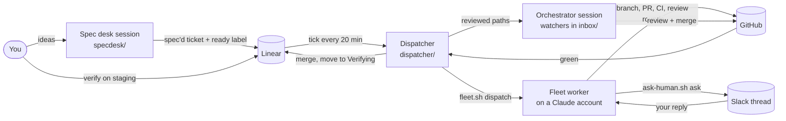

# The Forge

The Forge is a spec desk and an agent queue for Claude Code. You write spec'd Linear tickets in one pinned Claude session and label them ready. A dispatcher on each of your machines claims them, hands each to a Claude Code background worker on one of several Claude accounts, and watches the worker build one pull request. When CI and the AI review are green, the dispatcher merges it and moves the ticket to Verifying. Questions come to you in Slack, one thread per question, and the worker that asked is woken with your answer.

It is plain Node and bash with no dependencies. A dispatcher tick spends no tokens; the tokens go to the workers.

The project was called agent-queue before it was called The Forge. File names, the config file (`agent-queue.config.json`), the launchd labels (`dev.agent-queue.*`) and the folder names keep the old name on purpose, so there is nothing to rename after you clone it.

## The loop



1. **Spec.** The spec desk session (`specdesk/`) talks ideas through with you, plans the PRs, and writes one ticket per PR with the spec floor (`docs/ticket-spec.md`): acceptance scenarios, adverse data, out of scope and decisions. It adds the ready label once the ticket meets the queue bar.
2. **Claim.** Every 20 minutes the dispatcher (`dispatcher/`) checks each ready ticket's mechanical bar (scenarios, size, priority), takes them by priority then age, and picks the Claude account with the most headroom that has a free slot. It can bundle up to three small linked tickets into one PR.
3. **Build.** The worker gets `dispatcher/worker-brief.md` with the ticket pasted in. It builds the full spec in its own worktree, pushes through the pre-push gates, opens the PR, and drives CI and the review rounds (`docs/pr-review.md`) until the PR is green.
4. **Ask.** When the worker hits a decision the ticket doesn't settle, it runs `inbox/ask-human.sh ask`. The question lands on the ticket and in your Slack channel. The worker keeps building whatever the question doesn't block, waits in the background, and is woken when you reply in the thread.
5. **Merge.** The dispatcher merges a green PR after checking it against current main (`dispatcher/premerge-check.mjs`). A PR that touches a reviewed path (migrations, workflows, auth, billing and the like) goes to your orchestrator session instead, which reviews and merges it. A red main holds every merge while an emergency worker fixes it (`dispatcher/main-watch.mjs`).
6. **Verify.** The ticket lands in Verifying. You (or your own verify session) walk its acceptance scenarios on staging and close it (`docs/build-process.md`).
7. **Learn.** A weekly sweep (`learning/`) ranks the failure types that keep repeating across agent-built work, so each one becomes a fix at the cheapest level that enforces it.

`docs/decisions.md` has the reasoning behind each of these rules.

## What's in the repo

| Folder | What it does |
|---|---|
| `agent-queue.config.example.json` | The one config. Every key is documented inline (the `...Note` keys). Copy it to `agent-queue.config.json`. |
| `lib/config.mjs` | Loads the config for every component, and prints values for the shell scripts. |
| `specdesk/` | The spec desk's standing brief (`SPECDESK.md`) and its Claude Code skill. |
| `dispatcher/` | The queue: `dispatcher.mjs` (the tick), `worker-brief.md`, `premerge-check.mjs`, `main-watch.mjs` (red-main responder), `gated-push.mjs`, `install.sh` (launchd or systemd). Its README has the full behavior. |
| `fleet/` | `fleet.sh`: start, list, read and stop Claude Code background sessions on several Claude accounts on one machine, with plan usage per account. Plus its skill and account setup. |
| `inbox/` | `ask-human.sh` (the inbox for questions, in Linear and Slack), the orchestrator's watchers (`inbox-watch.sh`, `merge-request-watch.sh`, `main-red-watch.sh`), and the merge helpers (`merge-approved.sh`, `merge-when-ready.sh`, `merged-to-verifying.mjs`). |
| `queue-board/` | The Forge's board: a web page that shows every machine's worker slots, tickets, PRs, asks and worktrees, drawn as Middle-earth in two views, with a herald that plays alert cues and posts notifications, an installable app and its own icon. Also `hourly-check.mjs`, which wakes the orchestrator only when something new needs attention. Its README has every feature. |
| `learning/` | The weekly failure sweep. |
| `scripts/` | `ext-agent.sh` (headless, read-only Codex and Grok calls) and `cross-review.sh` (a pre-push review by both). |
| `docs/` | The ticket spec floor, the PR review loop, the build-to-done loop, the no-stubs rule, memory hygiene, and the decisions. |

## Prerequisites

- **Claude Code**, signed in. Several Claude accounts make it worthwhile: each account has its own 5-hour and weekly limits, and the dispatcher spreads work across them (`fleet/README.md` explains the account folders). One account works too.
- **Node 22 or newer**, `git`, `jq`, `curl`, and on macOS the stock bash 3.2 is enough.
- **GitHub CLI** (`gh`), logged in as the account the dispatcher merges with (`github.user`). The repo needs CI on pull requests and, ideally, an AI review check (`github.reviewCheck`, for example Claude Code Review).
- **Linear**, with a personal API key (`linear.apiKeyCommand`, `LINEAR_API_KEY`, or a file), a team, workflow states for In Progress and Verifying, a Size label group (S, M, L), and these labels: ready, building, stuck, needs-human. A saved view for the queue labels and one for needs-human make good sidebars.
- **Slack**, optional but recommended: one private channel, an app with an incoming webhook (progress lines) and a bot token with `chat:write` (asks and the reviewer DM), and Linear's Slack app in the channel for synced threads.
- **Codex and Grok CLIs**, optional, for `scripts/ext-agent.sh` and `scripts/cross-review.sh`.
- **A file-sync tool** (any one that keeps a folder identical), only when more than one machine runs the queue, to keep `paths.sharedDir` the same on each.

## Set up a machine

1. Clone this repo, for example to `~/dev/the-forge`.
2. Copy the config and fill it in:
   ```bash
   cp agent-queue.config.example.json agent-queue.config.json
   ```
   At minimum set `human.name`, `repoPath`, `workspaceCwd`, `github.repo`, `github.user`, `linear.workspace`, `linear.team`, `linear.inboxProject`, the `slack` IDs, and `dispatcher.enabledHosts` and `dispatcher.hosts` with this machine's `hostname -s`.
3. Put the secrets in the state folder (default `~/.agent-queue`), mode 600:
   ```bash
   mkdir -p ~/.agent-queue && chmod 700 ~/.agent-queue
   ```
   - `linear-api-key` (or set `linear.apiKeyCommand` to a secrets manager command),
   - `slack-webhook`, the incoming-webhook URL,
   - `slack-bot-token`, the bot token.
4. Add your Claude accounts to the fleet (`fleet/README.md`), then check them:
   ```bash
   fleet/fleet.sh accounts
   ```
5. Link the skills and scripts into Claude Code, so every session can find them:
   ```bash
   ln -s ~/dev/the-forge/specdesk/skill ~/.claude/skills/specdesk
   ```
   ```bash
   ln -s ~/dev/the-forge/fleet ~/.claude/skills/fleet
   ```
   ```bash
   ln -s ~/dev/the-forge/inbox/ask-human.sh ~/.claude/scripts/ask-human.sh
   ```
6. Try the queue without changing anything:
   ```bash
   node dispatcher/dispatcher.mjs tick --dry-run
   ```
7. Install the scheduled jobs. The dispatcher runs on every queue machine; the red-main watcher and the board on one:
   ```bash
   dispatcher/install.sh
   ```
   ```bash
   dispatcher/install.sh --main-watch
   ```
   ```bash
   queue-board/install.sh
   ```
8. Open a Claude Code session, pin it, name it after `orchestrator.sessionName`, and run `/specdesk`. In it, start the watchers with Bash `run_in_background` so the session is woken when something needs it: `inbox/inbox-watch.sh`, `inbox/merge-request-watch.sh`, `inbox/main-red-watch.sh` and `queue-board/hourly-check.mjs`. Re-arm each one after it wakes the session.

More machines: repeat on each, with the same `paths.sharedDir` synced between them and each machine's hostname in `dispatcher.hosts`.

## The board

`queue-board/` is the part of The Forge you look at. It is a web page that shows the whole queue across your machines: worker slots, tickets, PRs, CI and review state, what needs you, your Linear inbox, your Claude app sessions and every git worktree. Each machine is drawn as a realm of Middle-earth and each worker as a pixel figure acting out where its ticket stands, in two views: a side view and a map from above. A herald (`queue-board/install-herald.sh`) plays an alert cue and posts a macOS notification when something needs you or breaks, and the page can play your own music between alerts. The page installs as an app in Chrome and has its own icon. It is read-only and spends no Claude tokens. `queue-board/README.md` describes every view and every config key under `queueBoard`.

## Configuration

Everything specific to your team lives in `agent-queue.config.json`: repo paths and the GitHub repo, the Linear team (which is also the ticket prefix), label and state names, Slack IDs, the reviewer for judgment-path fixes, machine hostnames and per-host worker counts, fleet account labels, the human's name used in prompts, and model names. The example documents every key inline. `AGENT_QUEUE_CONFIG=/path/to/config.json` points every component at another file.

Shell scripts read the config through `node lib/config.mjs env`, which prints `AQ_<PATH>=value` lines (for example `AQ_LINEAR_TEAM`), or `node lib/config.mjs get <dot.path>` for one value.

## Tests

```bash
npm test
```

That runs the dispatcher, inbox and learning tests with `node --test`, all against throwaway homes and stubs; nothing real is read or written.

```bash
npm run test:fleet
```

That runs the fleet's test suite against a stub `claude`.

## Safety

- The dispatcher never writes code. A pause is a file the dispatcher re-reads before every merge and dispatch. Two stuck tickets in a row, or a real failure on main after a merge, pause it on their own.
- Workers run with Claude Code's `bypassPermissions` mode by default (`fleet.sh dispatch`), because they run unattended and a worker that stops at a permission prompt has stalled. In that mode a worker can run any command your user account can, and read any file it can. Run the queue under a user and on a machine where that is acceptable, keep tokens in a secrets manager or keychain where you can, and use the main-checkout guard hook (`fleet/hooks/`). `dispatcher.permissionMode` sets a stricter mode for every queue worker, at the cost of workers that may stop and wait.
- Workers push and open PRs; only the dispatcher or the orchestrator merges. Merging deploys staging at most: production stays a step a human starts.
- Keep tokens in the state folder or a secrets manager. The config holds IDs and names, never secrets.

No license has been chosen yet.
